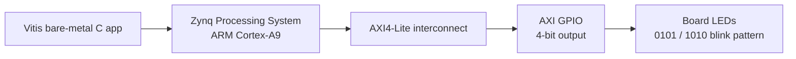

# Tutorial ZYNQ SoC: First Zynq Design


This repository contains a rebuilt Lab 01 project for a basic Zynq SoC system using Vivado IP Integrator and Vitis 2022.2. The design connects the Zynq Processing System to an AXI GPIO peripheral, then controls four board LEDs from a bare-metal C application running on the ARM Cortex-A9 processor.

## Project Overview

The goal of this lab is to demonstrate the first complete hardware/software co-design flow on a Zynq-7000 device:

- Create a Zynq Processing System block design in Vivado.
- Add and configure an AXI GPIO peripheral as a 4-bit LED output.
- Connect the AXI GPIO to the PS through the AXI GP master interface.
- Generate a bitstream and export the hardware platform as an XSA file.
- Build a Vitis bare-metal application that drives the LEDs through the AXI GPIO driver.

## System Architecture



## Hardware Configuration

| Item | Value |
| --- | --- |
| Tool version | Vivado / Vitis 2022.2 |
| Device part | `xc7z020clg484-1` |
| Board setting in project | `xilinx.com:zc702:part0:1.4` |
| Main hardware block | `processing_system7_0` |
| PL peripheral | `axi_gpio_0` |
| GPIO width | 4 bits |
| GPIO direction | Output |
| AXI GPIO base address | `0x41200000` |
| Exported hardware | `exports/first_zynq_system_wrapper.xsa` |
| Bitstream | `exports/first_zynq_system_wrapper.bit` |

## Software Behavior

The Vitis application initializes the AXI GPIO driver and continuously alternates the LED output between two patterns:

| Pattern | Binary | Expected LED behavior |
| --- | --- | --- |
| `LED_PATTERN_A` | `0101` | LED0 and LED2 on |
| `LED_PATTERN_B` | `1010` | LED1 and LED3 on |

Serial output is also printed through `xil_printf` to confirm that the application is running.

## Repository Layout

```text
.
|-- exports/
|   |-- first_zynq_system_wrapper.bit
|   `-- first_zynq_system_wrapper.xsa
|-- hardware/
|   |-- first_zynq_design.xpr
|   `-- first_zynq_design.srcs/
|-- reports/
|   |-- route_status.rpt
|   |-- timing_summary_routed.rpt
|   `-- utilization_placed.rpt
|-- software/
|   `-- LED_test/
|       `-- src/
|           |-- LED_test_tut_1C.c
|           |-- Xilinx.spec
|           `-- lscript.ld
|-- .gitignore
`-- README.md
```

Generated Vivado/Vitis cache folders are intentionally excluded from version control. The repository keeps the source files, hardware export, reports, and application code needed to review or reproduce the lab.

## Reproduce The Design

1. Open Vivado 2022.2.
2. Open `hardware/first_zynq_design.xpr`.
3. Inspect the block design `first_zynq_system.bd`.
4. Regenerate output products if Vivado requests it.
5. Run synthesis, implementation, and bitstream generation.
6. Export hardware with bitstream to create a new `.xsa` if needed.
7. Open Vitis 2022.2 and create a platform from `exports/first_zynq_system_wrapper.xsa`.
8. Create a bare-metal application and use `software/LED_test/src/LED_test_tut_1C.c`.
9. Program the FPGA and run the application on the Zynq PS.

## Build Results

The rebuilt implementation completed routing successfully.

| Metric | Result |
| --- | ---: |
| Slice LUTs | 426 / 53,200 |
| Slice Registers | 551 / 106,400 |
| Block RAM Tile | 0 / 140 |
| DSPs | 0 / 220 |
| Bonded IOB | 4 / 200 |
| WNS | 11.948 ns |
| TNS | 0.000 ns |
| Routing errors | 0 |

## Skills Demonstrated

- Zynq Processing System configuration in Vivado IP Integrator.
- AXI4-Lite peripheral integration using AXI GPIO.
- Hardware export workflow from Vivado to Vitis.
- Bare-metal C development with Xilinx standalone BSP.
- Hardware/software co-design debugging on Zynq SoC.

## Notes

This project was rebuilt in Vivado/Vitis 2022.2 from the original Zynq tutorial flow. The focus is on a clean and reproducible lab repository rather than committing generated build caches.
