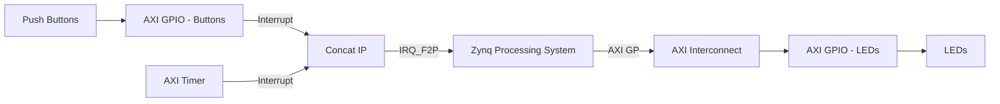

# Next Steps in Zynq SoC Design


This repository contains a Zynq hardware/software co-design lab focused on interrupt-driven embedded systems using the ARM Processing System and programmable logic peripherals.

The design targets a PYNQ-Z2 board and demonstrates how AXI peripherals in the PL can raise interrupts to software running on the Zynq PS.

## Project Overview

The system integrates:

- ZYNQ7 Processing System
- AXI GPIO for push buttons
- AXI GPIO for LEDs
- AXI Timer
- Concat IP for combining multiple interrupt sources
- ARM Generic Interrupt Controller through `IRQ_F2P`
- Standalone C applications built with Vitis

## Architecture



## Implemented Exercises

| Exercise | Focus | Source |
|---|---|---|
| 2B | Button interrupt counter | `sources/zynq_interrupts/interrupt_counter_tut_2B.c` |
| 2D | Button + timer interrupt counter | `sources/zynq_interrupts/interrupt_counter_tut_2D.c` |

## Behavior

### Button Interrupt Application

- Pressing a push button generates a GPIO interrupt.
- The interrupt handler reads the button value.
- The software counter is incremented based on the button bit pattern.
- The counter value is written to LEDs.

### Button + Timer Interrupt Application

- Push buttons and AXI Timer both generate interrupts.
- Button interrupts update the LED counter immediately.
- Timer interrupts increment an internal expiration counter.
- After three timer expirations, the LED counter increments automatically.

## Repository Layout

```text
.
|-- zynq_interrupts.xpr
|-- zynq_interrupts.srcs/
|   `-- sources_1/bd/zynq_interrupt_system/
|-- zynq_interrupt_system_wrapper.xsa
|-- sources/
|   `-- zynq_interrupts/
|       |-- interrupt_counter_tut_2B.c
|       `-- interrupt_counter_tut_2D.c
`-- README.md
```

## Software Components

The standalone C applications use Xilinx drivers:

| Driver | Purpose |
|---|---|
| `XGpio` | Read button GPIO and write LED GPIO |
| `XTmrCtr` | Configure and handle AXI Timer events |
| `XScuGic` | Configure the Zynq interrupt controller |
| `Xil_Exception` | Register and enable ARM exception handling |
| `xil_printf` | UART debug output |

## How to Reproduce

### Vivado Hardware Design

1. Open Vivado 2022.2.
2. Open `zynq_interrupts.xpr`.
3. Open the block design `zynq_interrupt_system`.
4. Validate the design.
5. Generate bitstream if hardware execution is required.
6. Export hardware with bitstream to generate/update the `.xsa`.

### Vitis Software

1. Create a Vitis platform from:

```text
zynq_interrupt_system_wrapper.xsa
```

2. Create a standalone application for `ps7_cortexa9_0`.
3. Add either:

```text
sources/zynq_interrupts/interrupt_counter_tut_2B.c
sources/zynq_interrupts/interrupt_counter_tut_2D.c
```

4. Build the application.
5. Program the FPGA and launch the application on hardware.

## Validation Results

The Vivado implementation met timing in the completed build.

| Metric | Result |
|---|---|
| Worst Negative Slack | 12.431 ns |
| Worst Hold Slack | 0.062 ns |
| Slice LUT usage | Approximately 1.74 percent |
| Slice register usage | Approximately 1.00 percent |

## Skills Demonstrated

- Zynq PS/PL integration in Vivado IP Integrator
- AXI GPIO and AXI Timer peripheral configuration
- Interrupt routing from PL to PS through `IRQ_F2P`
- ARM GIC setup using `XScuGic`
- Bare-metal interrupt service routines in C
- Hardware export and Vitis standalone application workflow

## Hardware Requirements

- PYNQ-Z2 board
- USB JTAG connection
- USB UART terminal
- Vivado/Vitis 2022.2 installation

Serial terminal settings:

```text
Baud rate : 115200
Data bits : 8
Parity    : None
Stop bits : 1
Flow ctrl : None
```

## Portfolio Notes

This project shows a practical interrupt-driven embedded design on Zynq: hardware peripherals generate events in programmable logic, and bare-metal C software responds through the ARM interrupt controller. It is a useful demonstration of PS/PL co-design beyond simple polling-based I/O.
